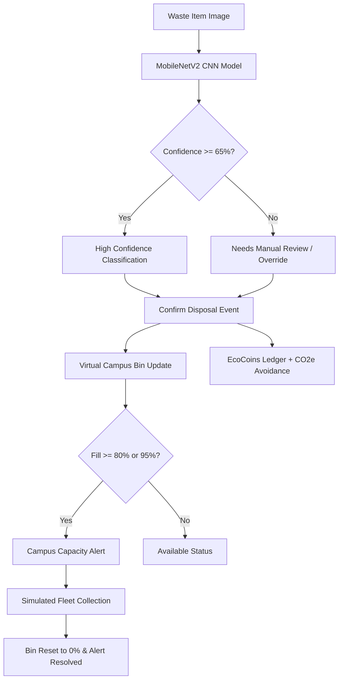

# EcoTwin - Campus Smart Waste Digital Twin

EcoTwin is an AI-powered Smart Waste Management and Circular Campus Digital Twin system. It integrates computer vision classification for automated waste segregation, real-time virtual telemetry for campus bins, capacity warning triggers, idempotent transaction ledgers, student incentive gamification (EcoCoins), and simulated carbon impact metrics.

---

## 1. Supported Waste Categories & Segregation Architecture

EcoTwin classifies waste into **six distinct categories** using a deep convolutional neural network:
1. `cardboard`
2. `glass`
3. `metal`
4. `paper`
5. `plastic`
6. `trash`

These six AI vision classes map to a configurable campus 3-stream segregation model:
* **Dry Recyclables (Blue):** Cardboard, Paper, Plastic (+10 to +15 EcoCoins reward)
* **Glass & Metals (Green):** Glass, Metal (+10 to +15 EcoCoins reward)
* **Residual Waste (Gray):** Residual Trash (0 EcoCoins reward)

---

## 2. System Architecture



---

## 3. Real Model Training & Evaluation Results

The vision classifier uses transfer learning on **MobileNetV2** (ImageNet backbone) with a custom dense classification head:
* **Total Dataset Size:** 2,527 images across 6 classes
* **Train / Validation Split:** 80% (2,022 images) / 20% (505 images)
* **Final Training Accuracy:** **87.69%**
* **Final Validation Accuracy:** **81.19%**
* **Validation Loss:** 0.5138
* **Pre-trained Weights Included:** `ecotwin/models/ecotwin_garbage_classifier.keras` (11.1 MB)
* **Dataset Source:** [Kaggle Garbage Classification Dataset](https://www.kaggle.com/datasets/mohemedas/garbage-classification)

---

## 4. Setup & Installation

### Prerequisites
* Python 3.10+ (tested on Python 3.14)
* Git

### 1. Clone the Repository
```bash
git clone https://github.com/vedashreekr28-create/DSU-hackathon.git
cd DSU-hackathon
```

### 2. Create and Activate Virtual Environment
```bash
python -m venv .venv
# On Windows:
.venv\Scripts\activate
# On Linux / macOS:
source .venv/bin/activate
```

### 3. Install Dependencies
```bash
pip install -r requirements.txt
```

---

## 5. Running the Application

### Option A: One-Click Launcher (Windows)
Double-click:
```cmd
run_ecotwin.bat
```

### Option B: Terminal Command
```bash
python ecotwin/src/app.py
```
Open your browser to:
👉 **http://127.0.0.1:5000**

---

## 6. Running Automated Tests

Run the full 9-point unit test suite verifying CNN inference, capacity calculations, idempotency, rewards ledger, alerts, and collection events:
```bash
python ecotwin/src/test_digital_twin.py
```

---

## 7. Interactive Features

* **Digital Twin Dashboard (`/`):** Live telemetry for 12 campus bins across 4 locations (Library, Cafeteria, Engineering Quad, Student Center), tracking fill levels, waste distributions, active alerts, and student incentive balances.
* **AI Waste Classifier (`/classify`):** Image upload or quick sample testing. Displays real confidence percentages, flags items below the 65% threshold for manual review, and allows manual category overrides to prevent contamination.
* **Virtual Sensor Simulator (`/simulator`):** Purely software-based IoT telemetry simulation. Adjust bin fill levels to test threshold alerts (≥80% Nearly Full, ≥95% Collection Required), alert deduplication, and fleet collection resets.

---

## 8. Disclaimers & Notes

* **Software-Only Architecture:** This system requires no physical hardware. Sensor telemetry and collection trucks are software-simulated.
* **Simulated Environmental Impact:** Carbon impact figures are simulated estimates derived from published EPA WARM and DEFRA circular recycling benchmark coefficients. These do not represent certified regulatory carbon credits, financial securities, or verified industrial offsets.
* **Bin Capacity:** Capacities are estimated volumetric metrics based on item counts and typical container geometry.
