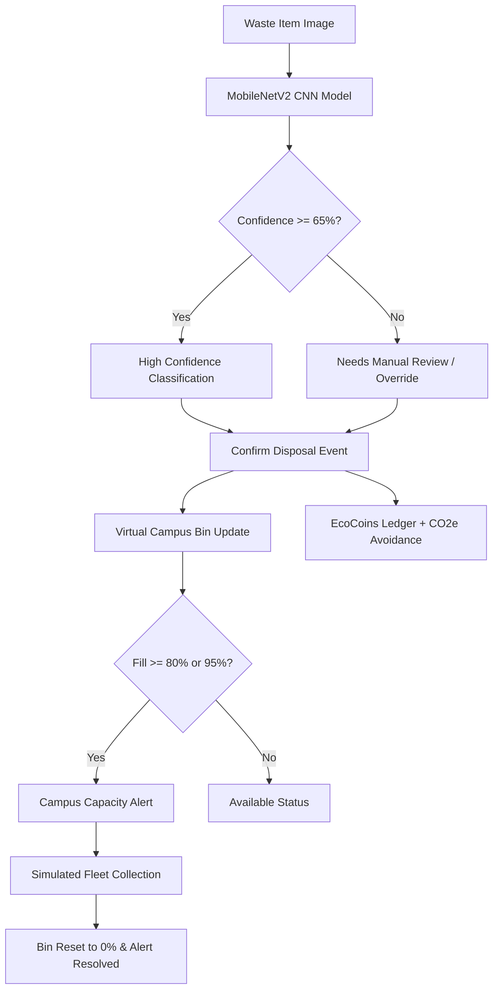

# EcoTwin - Campus Smart Waste Digital Twin

EcoTwin is an AI-powered Smart Waste Management and Circular Campus Digital Twin system. It integrates computer vision classification for automated waste segregation, real-time virtual telemetry for campus bins, capacity warning triggers, idempotent transaction ledgers, student incentive gamification (EcoCoins), and simulated carbon impact metrics.

---

## 1. Supported Waste Categories & Segregation Architecture

EcoTwin classifies waste into **six distinct categories** using a deep convolutional neural network:
1. `cardboard`
2. `glass`
3. `metal`
4. `paper`
5. `plastic`
6. `trash`

These six AI vision classes map to a configurable campus 3-stream segregation model:
* **Dry Recyclables (Blue):** Cardboard, Paper, Plastic (+10 to +15 EcoCoins reward)
* **Glass & Metals (Green):** Glass, Metal (+10 to +15 EcoCoins reward)
* **Residual Waste (Gray):** Residual Trash (0 EcoCoins reward)

---

## 2. System Architecture



---

## 3. Real Model Training & Evaluation Results

The vision classifier uses transfer learning on **MobileNetV2** (ImageNet backbone) with a custom dense classification head:
* **Total Dataset Size:** 2,527 images across 6 classes
* **Train / Validation Split:** 80% (2,022 images) / 20% (505 images)
* **Final Training Accuracy:** **87.69%**
* **Final Validation Accuracy:** **81.19%**
* **Validation Loss:** 0.5138
* **Pre-trained Weights Included:** `ecotwin/models/ecotwin_garbage_classifier.keras` (11.1 MB)
* **Dataset Source:** [Kaggle Garbage Classification Dataset](https://www.kaggle.com/datasets/mohemedas/garbage-classification)

---

## 4. Setup & Installation

### Prerequisites
* Python 3.10+ (tested on Python 3.14)
* Git

### 1. Clone the Repository
```bash
git clone https://github.com/vedashreekr28-create/DSU-hackathon.git
cd DSU-hackathon
```

### 2. Create and Activate Virtual Environment
```bash
python -m venv .venv
# On Windows:
.venv\Scripts\activate
# On Linux / macOS:
source .venv/bin/activate
```

### 3. Install Dependencies
```bash
pip install -r requirements.txt
```

### 4. Configure Environment Variables
Copy the template configuration file:
```bash
copy .env.example .env    # On Windows
# cp .env.example .env     # On Linux / macOS
```
Edit `.env` with your project settings:
* `SUPABASE_URL`: Your Supabase Project URL (`https://<project-ref>.supabase.co`)
* `SUPABASE_ANON_KEY` / `SUPABASE_SERVICE_ROLE_KEY`: Found in Supabase Dashboard -> Project Settings -> API.
* `SECRET_KEY`: Generate a random production secret: `python -c "import secrets; print(secrets.token_hex(24))"`

---

## 5. Running the Application

### Option A: One-Click Launcher (Windows)
Double-click:
```cmd
run_ecotwin.bat
```

### Option B: Terminal Command
```bash
python ecotwin/src/app.py
```
Open your browser to:
👉 **http://127.0.0.1:5000**

---

## 6. Running Automated Tests

Run the full automated test suites verifying CNN inference, capacity calculations, idempotency, rewards ledger, alerts, live camera restrictions, collection events, and Supabase PostgreSQL persistence:

```bash
# 1. Supabase PostgreSQL schema, views, and RLS test suite
python ecotwin/src/test_supabase_backend.py

# 2. Live Camera Only restrictions and validation test suite
python ecotwin/src/test_live_camera_workflow.py

# 3. Digital Twin core telemetry and idempotency test suite
python ecotwin/src/test_digital_twin.py
```

---

## 7. Supabase PostgreSQL Database Integration

EcoTwin features a production-grade **Supabase PostgreSQL** backend with a dual-engine architecture:
* **Live Supabase Cloud:** When `SUPABASE_URL` and `SUPABASE_SERVICE_ROLE_KEY` / `SUPABASE_ANON_KEY` are configured in `.env`, the system automatically persists all classifications, circular operations, and bin telemetry to Supabase.
* **Local Schema Replica:** When running in offline or demo mode without credentials, it automatically falls back to an identical local database replica, ensuring zero downtime and complete local testing without breaking.

### Database Tables:
1. `waste_classifications`: Stores every classification from live camera captures (`id`, `waste_category`, `confidence`, `model_version`, `capture_source='live_camera'`, `classification_status`, `created_at`, `metadata`). **Image data and base64 strings are strictly prohibited from permanent storage.**
2. `recycling_operations`: Tracks circular digital-twin operations (`id`, `classification_id`, `processing_pathway`, `operation_status`, `is_simulated`, timestamps). Pathways: `recycling`, `landfill`, `pending_review`, `composting`, `special_handling`. Uncertain classifications (<65% confidence) are automatically held for review.
3. `recycling_bins`: Virtual campus segregation bins tracking `capacity_kg`, `current_load_kg`, `item_count`, and status (`available`, `near_capacity`, `full`). Weights are derived from benchmark emission factors rather than invented from photographs.

### Dashboard SQL Views:
* `view_total_classifications`: Total and successful counts, average confidence, last active timestamp.
* `view_category_distribution`: Category-wise breakdown with percentage distribution.
* `view_recent_classifications`: Live audit stream joining classifications and circular processing pathways.
* `view_pathway_summary`: Processing pathway aggregates with completed and pending review totals.
* `view_operations_status`: Operational counts across pending, processing, completed, and failed states.
* `view_bin_utilization`: Capacity, kilogram load, item count, and fill percentages per virtual bin.

### Applying Migrations to Supabase:
1. Log in to [Supabase Dashboard](https://supabase.com/dashboard) and select your project.
2. Go to **SQL Editor** -> **New Query**.
3. Copy the contents of [`supabase/migrations/001_initial_schema.sql`](supabase/migrations/001_initial_schema.sql) and paste them into the editor.
4. Click **Run**.
5. Copy your project credentials into `.env`:
   ```bash
   cp .env.example .env
   # Edit .env with your SUPABASE_URL and SUPABASE_ANON_KEY / SUPABASE_SERVICE_ROLE_KEY
   ```

---

## 8. Interactive Features

* **Digital Twin Dashboard (`/`):** Live telemetry for 12 campus bins across 4 locations (Library, Cafeteria, Engineering Quad, Student Center), tracking fill levels, waste distributions, active alerts, and student incentive balances.
* **AI Waste Classifier (`/classify`):** Real-time live camera capture only using native `navigator.mediaDevices.getUserMedia()`. Captures a live frame from device video, displays real MobileNetV2 confidence percentages, disposal guidance, circular recycling pathways, and updates the digital twin database. File uploads, gallery browsing, and prerecorded videos are strictly rejected by the workflow and API.
* **Virtual Sensor Simulator (`/simulator`):** Purely software-based IoT telemetry simulation. Adjust bin fill levels to test threshold alerts (≥80% Nearly Full, ≥95% Collection Required), alert deduplication, and fleet collection resets.

---

## 9. Disclaimers & Notes

* **Software-Only Architecture:** This system requires no physical hardware. Sensor telemetry and collection trucks are software-simulated.
* **Simulated Environmental Impact:** Carbon impact figures are simulated estimates derived from published EPA WARM and DEFRA circular recycling benchmark coefficients. These do not represent certified regulatory carbon credits, financial securities, or verified industrial offsets.
* **Bin Capacity:** Capacities are estimated volumetric metrics based on item counts and typical container geometry.

---

## 10. Vercel Deployment & Architecture

EcoTwin is architected for seamless hybrid serverless deployment on Vercel:

### Why Decoupled Serverless Architecture?
1. **Serverless Bundle Size Limit:** Vercel functions have a strict **250 MB uncompressed limit**. A standard `tensorflow` installation on Linux is ~500 MB+, which exceeds serverless package limits.
2. **Ephemeral Storage:** Serverless filesystem writes are ephemeral. On Vercel, the application automatically uses `/tmp/ecotwin.db` for the session database, keeping the function fully functional without write-lock errors.
3. **Decoupled AI Inference:** 
   * **Local Environment:** Uses the local trained MobileNetV2 CNN directly.
   * **Vercel Cloud:** To run real AI classification in production, configure the `INFERENCE_API_URL` environment variable in the Vercel project dashboard to point to a hosted inference worker (e.g. Hugging Face Spaces or Render). Predictions and confidence scores are never fabricated.

### Deploying to Vercel in 2 Minutes:
1. Log in to [Vercel](https://vercel.com) and click **"Add New Project"**.
2. Select your repository: `vedashreekr28-create/DSU-hackathon`.
3. In Project Settings:
   * **Framework Preset:** `Other`
   * **Root Directory:** `./`
4. Click **Deploy**. Vercel will install `requirements.txt` and map all routes through `api/index.py` via `vercel.json`.

